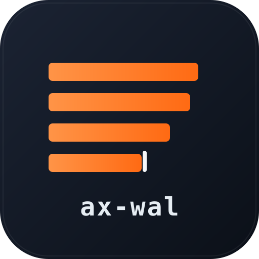

<p align="center">
  
</p>

# ax-wal

A single-writer / many-reader, file-system-backed Write-Ahead Log for Go.
Append-only, durable, with at-least-once tail-and-follow semantics; meant as
a building block for queues, replication logs, audit trails, and metric
buffers.

```
producer ──► [writer fsync ─► segment file] ─► fsnotify ─► [reader → Ack]
                                            ╲                  ╱
                                             cursor file (per reader)
```

## What it is

- **Single writer, N readers.** Writer holds an exclusive `flock` on the
  directory; readers each register a unique cursor. Both can be in different
  processes or different machines on the same filesystem.
- **CRC32C-framed records.** Torn writes at crash time are detected and
  truncated by recovery; corruption inside a closed segment is reported, not
  silently swallowed.
- **Tail-and-follow.** `Reader.Next(ctx)` blocks until new records arrive;
  uses fsnotify with a polling fallback. `Reader.NextBatch(ctx, max)` for
  amortizing per-record overhead.
- **Auto-rotation.** By size, by age, by record count, on wall-clock
  boundaries (`RotateAligned`: every hour at :00, daily at 00:00) — any
  combination.
- **Cursor-aware retention** with optional time-based hard-purge
  (`MaxRetainAge`). Stale readers (heartbeat older than TTL) are excluded
  from the cursor floor so one dead consumer can't fill the disk.
- **Built-in archiver.** Set `WriterOptions.Archive` and every closed
  segment is streamed to Backblaze B2 / S3 / a directory, verified, retried
  on failure, and only then marked `.archived` for retention. A manifest in
  the bucket catalogs index ranges, record times, checksums and key
  fingerprints; `OpenArchiveReader` reads records straight back from it.
- **Disk protection.** `MinRetainAge` keeps segments locally for N days,
  `MaxTotalBytes` / `MinFreeBytes` evict the oldest archived ones under
  pressure, and a configurable policy decides what `Append` does when
  nothing can be deleted.
- **Non-blocking append.** `AppendAsync` puts a record in a bounded queue
  and returns; overflow is dropped and counted.
- **Tunable durability.** `SyncFull` / `SyncBarrier` / `SyncNone` — pick the
  trade-off between latency, throughput, and survivability of last-second
  writes. Pair with `GroupCommit` to amortize fsync cost across concurrent
  writers; on the read side `AckBatchInterval` does the same for cursor
  fsyncs (~1.7 M reads/s in our bench when both sides are batched).
- **Optional encryption-at-rest** via AES-256-GCM. Bring-your-own-key,
  rotate it without stopping the writer.
- **Optional `mmap` reads** for huge cold replays.
- **Built-in replication.** `axwal.Mirror(ctx, ...)` library + `axwal-mirror`
  binary copy a primary WAL to a follower in real time.
- **Operational tooling.** `axwal-cli ls / cursors / stats / verify / fsck /
  dump / restore / compact / tail / mark-archived / archive`.
- **Stats and structured logging.** `Writer.Stats()` / `Reader.Stats()`
  return atomic counters; logs go through `*slog.Logger` with `dir` and
  reader `name` keys on every line.
- **Crash-tested.** Property-based test runs 30 randomized
  Append/AppendBatch/Rotate/SIGKILL sequences and asserts every committed
  record is readable after recovery.

## What it isn't

- Not a network-attached message broker. There's no consumer-group protocol,
  no JOIN/LEAVE handshake, no leader election — you give it a filesystem
  and a process, and it gives you a durable log.
- Not multi-writer. The `flock` on the directory is by design.
- Not Windows. The lock and per-OS sync helpers are POSIX (Linux + macOS
  tested).

## Quick start

```go
import axwal "github.com/axgrid/ax-wal"

// Producer
w, _ := axwal.OpenWriter(axwal.WriterOptions{
    Dir:            "/var/wal/orders",
    MaxSegmentSize: 64 << 20,
})
defer w.Close()
idx, _ := w.Append([]byte("order-42"))
fmt.Println("durable at index", idx)

// Consumer (any number of these, each in its own process)
r, _ := axwal.OpenReader(axwal.ReaderOptions{
    Dir:       "/var/wal/orders",
    Name:      "billing-worker-1",
    StartFrom: axwal.StartEarliest,
})
defer r.Close()
for {
    payload, idx, err := r.Next(ctx)
    if err != nil { break }
    process(payload)
    _ = r.Ack(idx)
}
```

## Configuration

### Writer

```go
type WriterOptions struct {
    Dir                 string
    MaxSegmentSize      int64
    MaxSegmentAge       time.Duration
    MaxSegmentRecords   uint64
    RotateAligned       time.Duration // wall-clock rotation: time.Hour, 24*time.Hour
    RotateLocation      *time.Location // zone for RotateAligned, default UTC
    RotateOnClose       bool          // Close() finishes the last segment like a rotation
    Archive             *ArchiveConfig // built-in uploader, see "Archiving"
    AsyncQueueSize      int           // > 0 enables AppendAsync
    AsyncQueueBytes     int64         // optional byte bound for the async queue
    AsyncBatchSize      int           // records per background write, default 256
    PreallocateSegments bool          // fallocate / F_PREALLOCATE
    CompressOnRotate    bool          // async zstd
    OnRotate            func(SegmentInfo)
    WriteMetaSidecar    bool          // wal-F-L.meta JSON with sha256
    SyncMode            SyncMode      // Full / Barrier / None
    GroupCommit         GroupCommitConfig
    Retention           RetentionConfig
    Encryption          *EncryptionConfig
    MaxPendingBytes     int           // backpressure ceiling
    BufferSize          int
    VerifyOnOpen        bool          // CRC-walk + dedupe + gap report on open
    Logger              *slog.Logger
    CloseTimeout        time.Duration // bounded shutdown
}
```

### Reader

```go
type ReaderOptions struct {
    Dir               string
    Name              string         // unique per active reader
    StartFrom         StartPosition  // Earliest | Latest | At
    StartAtIndex      uint64
    HeartbeatInterval time.Duration  // < StaleReaderTTL/2
    AckBatchInterval  time.Duration  // 0 = strict per-Ack fsync
    PollInterval      time.Duration  // fsnotify fallback
    UseMmap           bool           // mmap closed uncompressed segments
    SkipCorruptSegments bool         // move past a damaged closed segment instead of failing
    Encryption        *EncryptionConfig
    Logger            *slog.Logger
}
```

Full reader guide — every option, start positions, acks, errors, remote
and archive readers, CLI flags (in Russian): [docs/READER.md](docs/READER.md).

#### What a reader does when the log changes under it

A reader never hands out a record under the wrong index and never stalls
silently. `Next` either delivers the next record, waits because the log
really ends there, skips a hole that really exists (and reports it), or
returns an error.

| Situation | Behavior |
|---|---|
| End of the log; writer idle, closed, or not started yet | `Next` blocks until a record arrives or `ctx` ends. |
| Segment rotated / compressed / archived while being read | Transparent. A file that vanishes between listing and opening is looked up again, not reported as an error. |
| Segment deleted behind the reader's cursor (retention after archive) | Nothing to notice — retention never deletes what a live reader hasn't acknowledged. |
| Records the reader still needs are gone: `TruncatePrefix`, `MaxRetainAge`, a segment removed by hand, the log starts later than the reader's position | After the hole has persisted for 1 s the reader jumps to the first index that exists, logs a warning with the missing range, and counts it in `Stats().SkippedRecords`. |
| Reader was away and comes back | Resumes after its last `Ack`; if that position no longer exists, fast-forwards at `OpenReader`. |
| Writer crashed mid-record (torn tail in the open segment) | Waits. The restarted writer cuts the tail off and the reader continues with the next real record. |
| Writer lost its tail and is now *behind* the reader's position | Waits for the log to reach that index again (one warning is logged). |
| Closed segment damaged: CRC mismatch, file shorter than its name says, undecodable zstd | Default: `Next` returns the error (`ErrCorruptRecord` / `ErrTruncatedRecord`) and keeps returning it. With `SkipCorruptSegments`: logs an error, gives up the rest of that segment (`SkippedRecords`), continues with the next. |
| Open segment damaged while the writer keeps appending past it | `Next` returns `ErrCorruptRecord` (sticky). Once the segment rotates, the closed-segment rule applies. |

Alert on `SkippedRecords > 0` if a reader must not lose records.

### SyncMode — the durability dial

| Mode | Behavior | macOS cost | Linux cost | Loss on hard crash |
|---|---|---|---|---|
| `SyncFull` (default) | `*os.File.Sync()` | F_FULLFSYNC, ~5–15 ms | fsync, ~3–4 ms | nothing acked is lost |
| `SyncBarrier` | order-only barrier | F_BARRIERFSYNC, ~0.4 ms | fdatasync, ~3 ms | last few hundred ms |
| `SyncNone` | no flush | none | none | last few seconds |

`Writer.Sync()` always does a hard fsync regardless of `SyncMode` — use it
when you've opted into a weaker mode but need a guarantee right now (e.g.,
before reporting "transaction committed" upstream).

### GroupCommit — amortizing fsync cost

```go
type GroupCommitConfig struct {
    Enabled       bool
    MaxLatency    time.Duration  // default 1ms
    MaxBatchBytes int            // default 1 MiB
}
```

Concurrent `Append` calls share a single fsync. Each call still **blocks**
until its records are durable — semantics unchanged, throughput up. Larger
`MaxLatency` = more records per fsync = higher throughput, at the cost of
latency. `AppendContext(ctx, …)` and `AppendBatchContext(ctx, …)` respect
ctx cancellation while waiting on the cond.

**Anti-pattern**: GroupCommit + SyncBarrier or SyncNone — the per-fsync cost
is already cheap, so the 1 ms commit window becomes the dominant latency
and you give up most of the speed you came for.

### AckBatchInterval — the reader's group commit

Per-record `Ack()` does an fsync of the cursor file. On macOS that caps a
single reader at ~70 records/s; on Linux ~60. Setting `AckBatchInterval > 0`
makes `Ack()` lock-free and lets a background goroutine fsync the cursor at
that interval. A clean `Close()` always flushes the latest Ack first.

| AckBatchInterval | Ack call cost | Records re-delivered after hard kill |
|---|---|---|
| 0 (strict) | 1 fsync | 0 (after the last successful Ack) |
| 10 ms | atomic update | up to 10 ms × throughput |
| 100 ms | atomic update | up to 100 ms × throughput |

### Retention

```go
type RetentionConfig struct {
    Enabled              bool
    Interval             time.Duration  // default 30s
    MinRetainRecords     uint64
    StaleReaderTTL       time.Duration  // default 60s
    RequireArchivedMark  bool           // gate on wal-F-L.archived sidecar
    MinRetainAge         time.Duration  // keep locally at least this long
    MaxRetainAge         time.Duration  // hard purge by age (compliance)
    MaxTotalBytes        int64          // cap on the directory size
    MinFreeBytes         int64          // …or on free space of the filesystem
    OnDiskFull           DiskFullPolicy // Reject (default) | Drop | Ignore
}
```

A closed segment is deleted iff:

1. **Cursor cutoff:** all non-stale cursors have advanced past it.
2. **`MinRetainRecords` floor** is satisfied (keep last N records always).
3. **`MinRetainAge` has passed** — without it, a WAL nobody reads from
   loses its closed segments on the next janitor pass.
4. **OR `MaxRetainAge` expired** — segment older than this is deleted
   regardless of cursors. Pair with a documented consumer SLO.
5. **If `RequireArchivedMark`** is set (implied by `Archive`), a sibling
   `wal-F-L.archived` must also exist. The built-in archiver writes it;
   with your own uploader use `Writer.MarkArchived(F, L)` or
   `axwal-cli mark-archived`.

So "keep 7 days locally, never drop what isn't in the bucket yet, purge at
30 days no matter what" is:

```go
Retention: axwal.RetentionConfig{
    Enabled:      true,
    MinRetainAge: 7 * 24 * time.Hour,
    MaxRetainAge: 30 * 24 * time.Hour,
},
```

The active open segment is never touched.

#### Disk limits

`MaxTotalBytes` caps the size of the segment files; `MinFreeBytes` watches
the filesystem instead. When either is violated the janitor evicts the
oldest closed segments first, **ignoring `MinRetainAge` and
`MinRetainRecords`** — but never a segment that still waits for its
`.archived` mark, and never one a live reader hasn't consumed. Limits are
checked every `Interval` and after each rotation / upload, so leave about
one segment of headroom.

If the limit is exceeded and nothing may be deleted (archive unreachable,
foreign files filling the disk), `OnDiskFull` decides:

| Policy | `Append` | Counter |
|---|---|---|
| `DiskFullReject` (default) | returns `ErrDiskFull` | `Stats().DiskFullRejects` |
| `DiskFullDrop` | discards, returns `nil` (index 0) | `Stats().Dropped` |
| `DiskFullIgnore` | keeps writing | — |

`Stats().DiskFull` shows the current state. Writes resume by themselves as
soon as a pass gets back under the limit.

### Archiving

```go
import "github.com/axgrid/ax-wal/store/b2store"

w, err := axwal.OpenWriter(axwal.WriterOptions{
    Dir:              "/var/wal",
    CompressOnRotate: true,
    RotateAligned:    time.Hour,              // segments never span two hours
    Archive: &axwal.ArchiveConfig{
        Store:        b2store.New(keyID, appKey, bucket),
        Prefix:       "wal/kiosk-prod",
        Layout:       axwal.LayoutByDay,      // <prefix>/2026/10/11/wal-F-L.zst
        Concurrency:  2,
        Retry:        axwal.Backoff{Min: 5 * time.Second, Max: 10 * time.Minute},
        DrainOnClose: 20 * time.Second,       // Close waits for the last upload
    },
    Retention: axwal.RetentionConfig{Enabled: true, MinRetainAge: 7 * 24 * time.Hour},
})
```

What the archiver does:

- **Uploads every closed segment after compression** — it takes segments
  when they leave the rotation pipeline, not at `OnRotate` time.
- **Verifies before marking.** SHA-1 and SHA-256 are computed locally and
  sent with the upload (B2 checks the SHA-1, S3 the SHA-256 of the request
  body); afterwards the object is looked up in the store and its size (and
  SHA-1, where the backend reports one) compared. Only then is
  `wal-F-L.archived` written.
- **Retries forever** with `Retry` backoff. A segment stays pending until
  it is marked; every step is idempotent, so a retry re-sends nothing that
  already arrived and never produces a second object.
- **Picks up leftovers on open.** Pending = "closed segment without
  `.archived`", so segments from a previous run — including one finalized
  by crash recovery — are uploaded when the writer starts.
- **Streams.** Nothing is read into memory whole: a single PUT streams from
  the file, and anything above 128 MiB goes through B2 large-file / S3
  multipart, each part read directly from the file.
- **Keeps a manifest** at `<prefix>/manifest.json` (see below).

`Archive` implies `WriteMetaSidecar`, `RotateOnClose` and
`Retention.RequireArchivedMark`.

Stores:

| Package | Backend |
|---|---|
| `store/b2store` | Backblaze B2 native API — `b2store.New(keyID, appKey, bucket)` |
| `store/s3store` | S3 and compatibles (AWS, MinIO, R2, B2's S3 endpoint), SigV4 — `s3store.New(s3store.Config{…})` |
| `store/fsstore` | a local / mounted directory — `fsstore.New(dir)` |
| `store/storeurl` | opens any of the above from `b2://bucket/prefix`, `s3://bucket/prefix?region=…&endpoint=…`, `file:///dir`, with credentials from the environment (used by the CLIs) |

None of them pulls in an SDK. To plug in your own, implement three methods:

```go
type ArchiveStore interface {
    Put(ctx context.Context, key string, body io.Reader, info ArchivePutInfo) error
    Get(ctx context.Context, key string) (io.ReadCloser, error) // ErrObjectNotFound if missing
    List(ctx context.Context, prefix string) ([]ArchiveObject, error)
}
```

#### Manifest

`<prefix>/manifest.json` is rewritten after every upload and lists each
segment with its object key, index range, record count, size, SHA-1 /
SHA-256, compression, **time of the first and last record**, and the
**fingerprint of the encryption key** (`axwal.KeyFingerprint(key)`).
`axwal.LoadArchiveManifest(ctx, store, prefix)` returns it; if an archive
has no manifest it is reconstructed from a listing (times then come from
object modification times).

```bash
axwal-cli archive -store b2://bucket/wal/kiosk-prod          # table
axwal-cli archive -store b2://bucket/wal/kiosk-prod -json    # the manifest
```

The same record times and key fingerprint are in the local `wal-F-L.meta`
sidecar.

#### Reading from the archive

```go
r, err := axwal.OpenArchiveReader(ctx, axwal.ArchiveReaderOptions{
    Store:    store,
    Prefix:   "wal/kiosk-prod",
    FromTime: time.Date(2026, 9, 1, 0, 0, 0, 0, time.UTC),
    ToTime:   time.Date(2026, 9, 30, 23, 59, 59, 0, time.UTC),
    // or FromIndex / ToIndex
})
for {
    payload, idx, err := r.Next(ctx)
    if err == io.EOF { break }
    …
}
```

It needs nothing but the bucket: segments are downloaded one at a time to a
temp file, checked against the manifest, decompressed and decrypted.
Records carry no timestamps, so the time filter selects whole segments —
with `RotateAligned` that is exactly one rotation window. From the shell:

```bash
axwal-cli dump    -store b2://bucket/wal/kiosk-prod -since 2026-09-01 -until 2026-09-30 -raw
axwal-cli restore -store b2://bucket/wal/kiosk-prod -from 1 -to 50000 -dir /tmp/wal-copy
axwal-mirror      -store b2://bucket/wal/kiosk-prod -dst /srv/wal-copy   # follows new uploads
```

`axwal-mirror -store` (library: `MirrorOptions.SrcArchive`) replays the
archive into a local WAL and then keeps polling for new segments; its
position survives restarts in `<dst>/archive-mirror.pos`.

### Calendar rotation

`MaxSegmentAge` counts from the moment a segment was opened.
`RotateAligned` rotates on the clock instead: `time.Hour` cuts at every
:00, `24 * time.Hour` at 00:00 in `RotateLocation` (UTC by default). The
check happens on the write path, so a segment only ever contains records
appended within one window; an idle segment is closed by a timer within a
second of the boundary. With `LayoutByDay` the directory an object lands in
is therefore the day its records were written, not the day the file
happened to be closed.

### Non-blocking append

```go
w, _ := axwal.OpenWriter(axwal.WriterOptions{Dir: dir, AsyncQueueSize: 8192})

if err := w.AppendAsync(payload); err != nil {
    // ErrQueueFull: dropped (already counted in Stats().Dropped)
}
```

`AppendAsync` never waits for disk: it hands the record to a bounded queue
that a background goroutine writes out in batches. When the queue is full
(by `AsyncQueueSize` records or `AsyncQueueBytes`) the record is dropped
and counted. `Close()` writes out whatever is queued. Queued records are
not durable yet — use `Append` where that matters; both can be mixed on one
writer.

### Closing

`Close()` by default only renames the last segment to its closed form.
With `RotateOnClose` (implied by `Archive`) it runs the full rotation
pipeline on it — compression, `.meta`, `OnRotate` — so the tail is ready
for upload the moment the service stops, without a manual `Rotate()`.
`Archive.DrainOnClose` additionally waits that long for pending uploads.
`CloseTimeout` caps the whole shutdown; without it the pipeline gets 30 s.

### OnRotate, .meta sidecars, archived sidecars

Three independent extension points for the rotation path:

| Hook | Trigger | Use case |
|---|---|---|
| `OnRotate(SegmentInfo)` callback | After rename + (optional) zstd | In-process upload, replication trigger |
| `wal-F-L.meta` sidecar | If `WriteMetaSidecar` is set | Audit, backup verification (sha256), cloud catalog |
| `wal-F-L.archived` sidecar | Created by `MarkArchived` | Retention gate for out-of-process uploaders |

Panics in `OnRotate` are recovered and logged — they can't tear down the
writer.

### Encryption at rest

```go
key := loadKeyFromKMS() // 32 bytes for AES-256
opts := axwal.WriterOptions{
    Dir:        "/var/wal/encrypted",
    Encryption: &axwal.EncryptionConfig{Key: key},
}
```

Every record's payload is sealed with AES-256-GCM before framing. On-disk
body becomes `[12B random nonce | gcm_seal(plaintext)]`. The frame's CRC32C
still covers the full sealed body, so framing-layer corruption is detected
before the AEAD runs.

A reader without the key can scan framing (`verify`, `ls` work fine) but
gets `ErrEncryption` when it tries to read a record. Mismatched key →
`ErrEncryption`.

CLI tools accept `-key-file path/to/key` (raw 32 bytes).

**Key rotation.** `w.RotateKey(newKey)` rotates the active segment and
seals everything after it with the new key — no restart, and every segment
uses exactly one key. Readers take the current key plus the earlier ones:

```go
Encryption: &axwal.EncryptionConfig{Key: current, OldKeys: [][]byte{previous}}
```

The right key is picked per record by GCM authentication. To know which key
a year-old segment needs without trying, each segment's `.meta` sidecar and
its manifest entry carry `key_fingerprint` — compare with
`axwal.KeyFingerprint(key)`. (`axwal-cli dump -key-file … -old-key-files a,b`.)

### Reader.Lag / Reader.HeadIndex

```go
records, bytes, _ := r.Lag()
// records: number of committed indices past your cursor
// bytes:   estimated on-disk bytes from the cursor onward
```

Cheap (one glob). Use for "consumer falling behind" alerts.

### Reader.NextBatch

```go
payloads, indices, err := r.NextBatch(ctx, 256)
```

Up to N records in one call; blocks for the first, drains best-effort for
the rest. Cuts per-record overhead for batched processors (DB inserts, S3
multipart uploads).

### Writer.TruncatePrefix

```go
removed, _ := w.TruncatePrefix(uptoIndex)
```

Synchronously deletes closed segments where `LastIndex < uptoIndex`,
including their `.archived` and `.meta` sidecars. Bypasses cursor protection
— call when you know no consumer will need that range again.

### VerifyOnOpen

`OpenWriter(opts).VerifyOnOpen = true` triggers a full CRC walk of every
closed segment at startup. Catches:

- Bit-flips inside closed segments → segment removed (cluster redundancy /
  backups must repopulate).
- Duplicate ranges (`wal-1-100` and `wal-1-100.zst` coexist) → uncompressed
  twin removed, .zst kept.
- Gaps in the index chain → logged as warnings (the data was already lost).

Costly — proportional to total WAL size. Run on operator-suspected damage
or after pulling a backup.

### Replication / Mirror

Three deployment patterns, same Mirror primitive in all of them:

**(1) Local: both directories visible from one process**

```go
axwal.Mirror(ctx, axwal.MirrorOptions{
    SrcDir: "/shared/leader-wal",
    DstDir: "/local/follower-wal",
    Name:   "follower-1",
    BatchSize: 256,
})
```

```bash
axwal-mirror -src /shared/leader -dst /local/follower -name follower-1
```

**(2) Remote: TCP between two hosts**

On the primary:

```bash
axwal-serve -dir /var/wal -listen 127.0.0.1:9001
```

On the follower:

```bash
axwal-mirror -addr primary.local:9001 -dst /local/follower -name follower-1
```

The server itself is plain TCP — bind it to a private interface or
firewall the port. For exposed deployments, use pattern (3).

**(3) Remote with in-process SSH tunnel (recommended for production)**

`axwal-mirror` dials SSH itself; no external `ssh -L` process required.
The TCP socket between the two ax-wal processes never leaves localhost on
either side.

```bash
# Primary listens on 127.0.0.1 only — outsiders cannot reach the WAL
# without first authenticating to SSH on the same host.
axwal-serve -dir /var/wal -listen 127.0.0.1:9001
```

```bash
# Follower
axwal-mirror \
  -tunnel root@primary.example.com:22 \
  -ssh-agent                              \  # or -ssh-key ~/.ssh/id_ed25519
  -ssh-known-hosts ~/.ssh/known_hosts     \  # strict host-key verification
  -addr 127.0.0.1:9001                    \  # as seen from inside the SSH host
  -dst /local/follower                    \
  -name follower-1
```

Library equivalent:

```go
axwal.Mirror(ctx, axwal.MirrorOptions{
    SrcRemote: &axwal.RemoteReaderOptions{
        Addr: "127.0.0.1:9001",
        Name: "follower-1",
        SSHTunnel: &axwal.SSHTunnelConfig{
            Host:           "primary.example.com:22",
            User:           "root",
            KeyFile:        "/home/follower/.ssh/id_ed25519",
            KnownHostsFile: "/home/follower/.ssh/known_hosts",
        },
    },
    DstDir:    "/local/follower",
    BatchSize: 256,
})
```

Why this design:

- **No PKI needed.** SSH keys + known_hosts are already managed on every
  host with sshd. No certificate authority, no rotation tooling.
- **Confidentiality + integrity + authentication**, all from SSH.
- **Operational visibility**: connections show up in `sshd` audit logs.
- **Fits into existing firewalls**: only port 22 needs to be open; the
  WAL port stays on localhost.

Wire protocol:

```
HELLO  (client → server)   {name, start_index, batch_size} as JSON
OK     (server → client)   8B head_index
ERR    (server → client)   {error} as JSON
RECBATCH  (server → client) packed [index|len|payload] tuples
PING   (server → client)   keepalive on idle
ACK    (client → server)   8B last_received_index, periodic
```

No protobuf, no schema compiler — readable in a hex dump. See `wire.go`.

Indices align iff dst started fresh. For HA you can encrypt+mirror across
trust zones via `-src-key-file` / `-dst-key-file`. The follower can be
queried as a normal local WAL — readers register cursors as usual; the
mirror process is the only writer.

### Read-only replica

Operator guide with all modes, flags and failure cases (in Russian):
[docs/REPLICATION.md](docs/REPLICATION.md).

`Mirror` copies records; a **replica** is an exact, read-only copy of the
primary on another server — same record indices, nothing skipped, nothing
duplicated, and nobody else can write into it.

```bash
# primary
axwal-serve -dir /var/wal -listen 127.0.0.1:9001

# neighbouring server
axwal-mirror -replica -tunnel root@primary:22 -ssh-agent \
    -ssh-known-hosts ~/.ssh/known_hosts \
    -addr 127.0.0.1:9001 -dst /srv/wal-replica -name replica-1
```

or in-process: `axwal.Serve(ctx, …)` on the primary and
`axwal.RunReplica(ctx, axwal.ReplicaOptions{Dir, Source, Writer})` on the
other side.

- **Exact.** On every (re)connect the replica asks for "my last index + 1";
  its own WAL, not a cursor on the primary, decides where to continue. A
  record is acknowledged to the primary only after it is on the replica's
  disk.
- **SSH is the transport.** The replica dials SSH itself (key file or
  agent, `known_hosts` verification) and reaches `axwal-serve` bound to
  `127.0.0.1` on the primary through the tunnel — nothing but sshd is
  exposed. A direct TCP address works too (WireGuard, private network).
- **Self-healing.** Lost connection, restarted primary, restarted sshd:
  reconnects with backoff (1 s → 30 s) and catches up. A link that dies
  *silently* — no FIN, data just stops — is caught too: the server pings
  idle connections, and a replica that hears nothing for
  `RemoteReaderOptions.IdleTimeout` (60 s) drops the connection and dials
  again. The server lets the same replica name back in immediately,
  evicting the stale connection.
- **Readable.** Open a `Reader` on the replica directory like on any WAL —
  it tails records as they arrive. Or run `axwal-serve -dir
  /srv/wal-replica` there and attach `RemoteReader`s / further replicas.
- **Read-only.** The directory carries a `REPLICA` marker; `OpenWriter`
  (and therefore `restore`, `mirror`, your own service) fails with
  `ErrReplicaDir`. Readers work as on any WAL.
- **Never silently wrong.** If the primary has already deleted the records
  the replica needs next, or the replica is ahead of the primary, it stops
  with `ErrReplicaDiverged` instead of leaving a hole.
- **Failover.** Stop the replica process, `axwal-cli promote -dir
  /srv/wal-replica` (`axwal.PromoteReplica`), point the service at it —
  indices continue from the last replicated record.

Things to know:

- **Asynchronous by default.** `Append` returns when the record is durable
  on the primary; the replica gets it milliseconds later. Records the
  primary hadn't shipped when its disk died are lost — unless you turn on
  synchronous replication (next section).
- **Keep the primary from deleting unshipped segments**: the replica's
  cursor (`-name`) holds retention back only while its heartbeat is fresher
  than `Retention.StaleReaderTTL` (default 60 s). Raise it to the longest
  replica outage you want to survive, or the replica will stop with
  `ErrReplicaDiverged` and has to be re-seeded from an empty directory.
- Encrypted WALs are copied as stored: the replica needs no key, readers of
  the replica need the same keys as on the primary.
- Segment files are cut by the replica's own rotation settings; indices and
  payloads are what match.

#### Synchronous replication (opt-in)

The same trade MySQL offers as semi-sync replication: an append returns
only after a replica has the record on its disk.

```go
w, _ := axwal.OpenWriter(axwal.WriterOptions{
    Dir: "/var/wal",
    SyncReplication: &axwal.SyncReplicationConfig{
        Timeout: time.Second, // longest an append may be held up
    },
})
// The endpoint must live in the writer's process to pass acks to it:
go axwal.Serve(ctx, axwal.ServerOptions{Writer: w, Listen: "127.0.0.1:9001"})
```

- `Append` = durable locally **and** acknowledged by a replica (which acks
  after its own fsync). The wait happens outside the writer lock, so
  concurrent appenders share replica round trips.
- **It degrades instead of stalling.** If the replica doesn't acknowledge
  within `Timeout`, or disconnects, the writer switches to asynchronous
  mode: that one append returns successfully after `Timeout`, the following
  ones don't wait at all. Nothing fails; records are still durable locally
  and the replica keeps catching up.
- **It recovers by itself.** When the replica is back within `RecoverLag`
  records (default 1000) — and at least `Cooldown` (5 s) has passed since a
  timeout fallback, so a merely slow link doesn't flap — appends wait again.
- With no replica connected the writer is simply asynchronous.

Watch it: `Stats().SyncReplicationActive`, `SyncReplicationFallbacks`,
`ReplicasConnected`, `ReplicaAckedIndex` (lag = `LastIndex -
ReplicaAckedIndex`). The last two are filled whenever `Serve` runs with
`Writer` set, sync mode or not.

The guarantee holds only while `SyncReplicationActive` is true: a record
appended during a fallback window exists on the primary alone until the
replica catches up. Cost while active: one network round trip plus the
replica's fsync per append (per group of concurrent appends). A standalone
`axwal-serve` process can ship records but cannot report acknowledgements
to the writer — sync mode needs `Serve` in-process.

## Benchmarks

`cmd/axwal-bench` flag matrix. 4 concurrent writer goroutines, 1 KiB
payloads, 5 s runs. macOS = M1 Max NVMe; Linux = Hetzner 16-core NVMe RAID.

### Writer throughput (4 writers, 1 KiB)

| OS | SyncMode | GroupCommit | writes/s | wp50 | wp99 |
|---|---|---|---|---|---|
| macOS | Full | off | 157 | 24 ms | 46 ms |
| macOS | Full | on (1 ms) | 511 | 6.4 ms | 21 ms |
| macOS | **Barrier** | off | **2,393** | 1.2 ms | 17 ms |
| macOS | None | off | 13,364 | 7 µs | 7 ms |
| Linux | Full | off | 279 | 13 ms | 27 ms |
| Linux | **Full** | **on (1 ms)** | **820** | 4.5 ms | 10 ms |
| Linux | None | off | **280,741** | 3 µs | 339 µs |

### Reader throughput (replay 10 K × 1 KiB, single reader)

| OS | ack-every | AckBatchInterval | rate | total |
|---|---|---|---|---|
| macOS | 1 | 0 (strict) | 70/s | 2 m 23 s |
| macOS | 1 | **100 ms** | **1,334,697/s** | 7 ms |
| Linux | 1 | 0 (strict) | 58/s | 2 m 50 s |
| Linux | 1 | **10 ms** | **1,846,663/s** | 5.4 ms |

### Combined high-throughput, low-durability (4 writers, 1 KiB, 5 s)

Writer `SyncNone` + Reader `AckBatchInterval=10ms`, both batched:

| | writes/s | MB/s | read p50 | read p99 |
|---|---|---|---|---|
| macOS | 15,327 | 14.9 | 32 µs | 5.7 ms |
| Linux | **192,593** | 188 | 5 ms | 31 ms |

### 100K-record cold replay (single reader, AckBatchInterval=0, ack-every=100)

| size | macOS rate | macOS p99 | Linux rate | Linux p99 |
|---|---|---|---|---|
| 100 B | 7,476/s | 6 µs | 5,813/s | 4 µs |
| 1 KB | 7,275/s | 27 µs | 5,948/s | 16 µs |
| 10 KB | 6,985/s | 78 µs | 5,604/s | 34 µs |
| 100 KB | 5,764/s | 397 µs | 4,851/s | 132 µs |
| 1 MB | 2,036/s | 1.25 ms | 2,256/s | 833 µs |

Hit `~6 K rec/s` with `ack-every=100` is the cursor-fsync ceiling. Switch
to `AckBatchInterval` for the millions/sec regime.

## Choosing a configuration

| Use case | SyncMode | GroupCommit | AckBatchInterval | Encryption | Why |
|---|---|---|---|---|---|
| Financial transactions, audit log | `Full` | on, MaxLatency=2-5ms | 0 (per-Ack fsync) | optional | survive hardware crash; consumer must not re-process |
| General durable queue, K8s pod | `Full` | on, 1-2 ms | 10 ms | optional | strong durability on writer; reader replay window of 10 ms is tolerable for at-least-once consumers |
| Replicated to S3, local is cache | `Barrier` | off | 50–100 ms | none | data is uploaded externally so power loss costs at most a few seconds; reader is downstream of a queue, not a database |
| Metrics / observability events | `None` | off | 100 ms | none | lossy is fine; throughput dominates |
| HA primary + warm standby | `Full` + `OnRotate` | on | 10 ms | optional | mirror via axwal-mirror; crash on primary → promote follower |
| Compliance buffer (purge after 30d) | `Full` | on | 10 ms | yes | `MaxRetainAge=30d`, `RequireArchivedMark=true`, monitored consumer SLO |

### Anti-patterns

- **`SyncNone` + `GroupCommit.Enabled`** — group commit's timer becomes the
  bottleneck and you give up most of the throughput.
- **`SyncFull` + `AckBatchInterval=0` + lots of Acks** — reader caps at
  ~70 rec/s while writer is wasting throughput it can't deliver.
- **`HeartbeatInterval > StaleReaderTTL / 2`** — janitor will declare your
  reader dead between heartbeats and start GC'ing past its position.
- **`MaxSegmentAge < GroupCommit.MaxLatency`** — pointless: rotation will
  happen on every commit window.
- **`MaxRetainAge` without a consumer SLO** — old segments will be purged
  even if a consumer hasn't drained them. Lagging readers will be
  fast-forwarded with a warning.

## Tools

```bash
# Demo producer / consumer (single binaries)
go run ./cmd/producer -dir /tmp/wal -n 1000
go run ./cmd/consumer -dir /tmp/wal -name worker-1

# Bench / load test
go run ./cmd/axwal-bench -duration 10s -writers 4 -size 1024 \
    -sync-mode barrier -ack-batch 10ms
go run ./cmd/axwal-bench -suite -duration 5s -writers 4   # 100B..1MB
go run ./cmd/axwal-bench -dir /tmp/q -size 1024 -replay-count 100000

# Replication — local (both dirs accessible)
go run ./cmd/axwal-mirror -src /shared/leader -dst /local/follower \
    -name follower-1 -batch 256

# Replication — over the network (primary)
go run ./cmd/axwal-serve -dir /var/wal -listen 127.0.0.1:9001

# Replication — over the network (follower) via SSH tunnel
go run ./cmd/axwal-mirror -tunnel root@primary:22 -ssh-agent \
    -ssh-known-hosts ~/.ssh/known_hosts \
    -addr 127.0.0.1:9001 -dst /local/follower -name follower-1

# Admin
go run ./cmd/axwal-cli ls -dir /tmp/wal
go run ./cmd/axwal-cli cursors -dir /tmp/wal
go run ./cmd/axwal-cli stats -dir /tmp/wal
go run ./cmd/axwal-cli verify -dir /tmp/wal
go run ./cmd/axwal-cli fsck -dir /tmp/wal --fix
go run ./cmd/axwal-cli tail -dir /tmp/wal -name dbg [-key-file key.bin]
go run ./cmd/axwal-cli dump -dir /tmp/wal -from 1 -to 100 > dump.json   # stops at the last record
go run ./cmd/axwal-cli dump -dir /tmp/wal -raw                          # payloads as is, one per line
go run ./cmd/axwal-cli dump -dir /tmp/wal -jsonl                        # {"idx":1,"payload":{…}}
go run ./cmd/axwal-cli dump -dir /tmp/wal -follow                       # keep tailing
go run ./cmd/axwal-cli restore -dir /tmp/wal2 -src dump.json

# Archive (credentials: B2_KEY_ID/B2_APP_KEY or AWS_ACCESS_KEY_ID/AWS_SECRET_ACCESS_KEY)
go run ./cmd/axwal-cli archive -store b2://bucket/wal/prod
go run ./cmd/axwal-cli dump    -store b2://bucket/wal/prod -since 2026-09-01 -until 2026-09-30 -raw
go run ./cmd/axwal-cli restore -store s3://bucket/wal/prod?region=eu-central-1 -dir /tmp/wal2
go run ./cmd/axwal-mirror      -store b2://bucket/wal/prod -dst /srv/wal-copy
go run ./cmd/axwal-cli compact -dir /tmp/wal -range 1-1000
go run ./cmd/axwal-cli mark-archived -dir /tmp/wal -range 1-1000
```

## On-disk layout

```
/wal-dir/
  .writer.lock              flock + PID of the live writer (POSIX advisory lock)
  wal-1-1000                closed segment, indices 1..1000 inclusive
  wal-1001-2000.zst         closed + zstd-compressed
  wal-1001-2000.archived    "safely uploaded" mark: the built-in archiver or an external uploader
  wal-1001-2000.meta        rotation metadata (sha256, num_records, first/last
                            record time, key fingerprint) optional
  wal-2001-                 active segment (writer is appending)
  cursors/
    billing-worker-1.cursor   [magic][crc32c][JSON cursor record]
    billing-worker-1.lock     flock on the cursor name
```

Record framing inside a segment file:

```
+--------+--------+----------------+
|  len   |  crc32c (Castagnoli)    |  payload (or AES-256-GCM body)
| 4B BE  |        4B BE            |  len bytes
+--------+--------+----------------+
```

A torn write (crash mid-Append) leaves a partial frame at the file tail.
Recovery on `OpenWriter` re-walks the open segment with CRC validation,
truncates everything from the first corrupt/short frame onwards, and
renames the file to its proper closed form.

## Stats / metrics

```go
ws := w.Stats()  // LastIndex, CommitIndex, FsyncCalls, FsyncErrors,
                 // Rotations, AppendCalls, AppendBytes,
                 // BackpressureRejects, RetentionDeletes,
                 // Dropped, AsyncQueued, AsyncErrors, DiskFull, DiskFullRejects,
                 // ArchivePending, ArchivePendingBytes, ArchiveOldestPendingAge,
                 // ArchiveLastSuccess, ArchiveUploads, ArchiveErrors, …
rs := r.Stats()  // NextIndex, AckedIndex, NextCalls, AckCalls,
                 // SegmentSwitches, ErrCorruptSegs, WaitWakeups
```

Expose via your Prometheus registry / OTLP exporter; counters are atomic
and cheap to scrape every second.

Logs go through `*slog.Logger` (configurable via `WriterOptions.Logger` /
`ReaderOptions.Logger`). Every line carries `dir` and (for readers) `name`
as keys.

## Drop-in for legacy `github.com/axgrid/axq`

If you have existing code written against the older `github.com/axgrid/axq`
Writer/Reader interfaces, the `axqcompat` sub-module exposes ax-wal under
the same surface so call sites don't change:

```go
import (
    axwal    "github.com/axgrid/ax-wal"
    "github.com/axgrid/ax-wal/axqcompat"
    "github.com/axgrid/axq"      // legacy interfaces
)

rawW, _ := axwal.OpenWriter(axwal.WriterOptions{Dir: "/var/lib/wal"})
var w axq.Writer = mustWriter(axqcompat.NewWriter(axqcompat.WriterOptions{
    Writer: rawW, Dir: "/var/lib/wal",
    Name:   "tx-producer", CloseUnderlying: true,
}))

w.Push(payload)        // → ax-wal Writer.Append
w.LastFID()            // F of the open wal-{F}- segment
w.MinimalFID()         // F of the oldest segment still on disk
w.Performance()        // rec/s rolling 1-second window

// Reader side:
rawR, _ := axwal.OpenReader(axwal.ReaderOptions{Dir: "/var/lib/wal", Name: "consumer"})
r, _ := axqcompat.NewReader(axqcompat.ReaderOptions{
    Reader: rawR, Dir: "/var/lib/wal",
    Name:   "consumer", WriterName: "tx-producer",
    Ctx: ctx, CloseUnderlying: true,
})
for msg := range r.C() {
    if err := process(msg.Message()); err != nil {
        msg.Error(err)   // does NOT ack → next reader replay
        continue
    }
    msg.Done()           // → Reader.Ack(idx)
}
```

Sub-module's own `go.mod` keeps axq's heavy deps (gorm, zerolog, b2, uuid)
out of the lean core. See [`axqcompat/README.md`](axqcompat/README.md) for
the full method-by-method mapping table.

## Limits

- 256 MiB hard cap per individual record (`maxRecordSize` in `framing.go`).
- A segment can grow up to `int64` bytes; in practice constrained by your
  rotation policy.
- The single-writer `flock` is *advisory*. Two processes that ignore the
  lock (e.g., one of them on a network filesystem with broken locking) can
  corrupt the WAL. On a local Linux/macOS filesystem the lock is honored.
- Reader is single-goroutine (`Next` is not safe for concurrent use).
  Spawn multiple Readers with distinct cursor names instead.
- Mirror preserves record ORDER, not necessarily INDICES across cycles —
  align by starting dst from a fresh empty directory.

## Tested on

- macOS (Apple M1 Max, Darwin 25.4, Go 1.23)
- Linux (Ubuntu 22.04, x86_64 16-core NVMe RAID, Go 1.23)
- CI: GitHub Actions matrix `linux/macos × go 1.23` running `go vet` +
  `go test -race` + a smoke benchmark.

## License

(unset)
